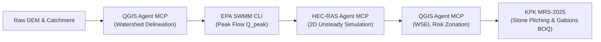
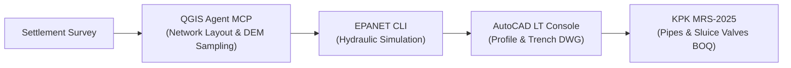
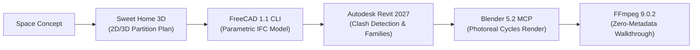
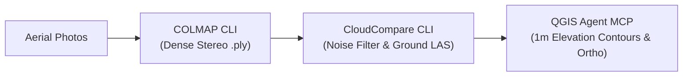
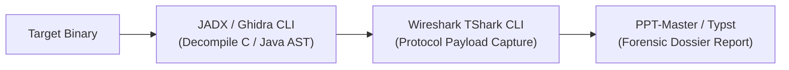
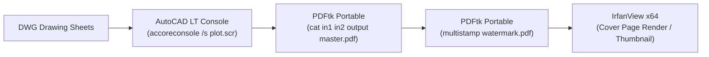
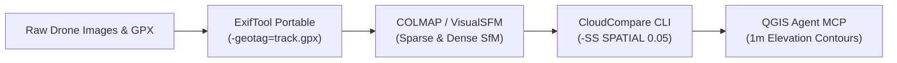
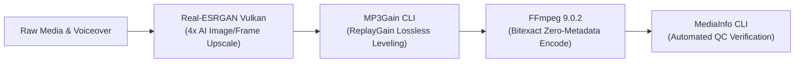
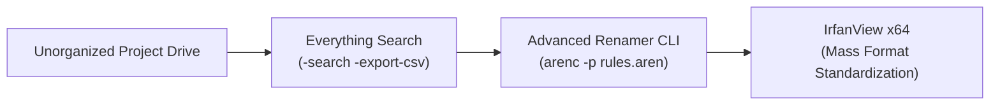

# PC Application Operation Matrix & Tool Orchestration Sequences

This document provides the authoritative operational reference, headless CLI commands, MCP server contracts, and optimal execution sequences for all engineering, CAD/BIM, geospatial, reverse engineering, and media applications installed on this PC.

---

## 1. Verified Applications & Operational Interfaces Matrix

| Application | Category | Executable Path / Interface | Operational Command & Syntax |
| :--- | :--- | :--- | :--- |
| **QGIS 4.2.3** | Geospatial & Hydrology | `qgis_agent_mcp` (MCP)<br>`C:\Program Files\QGIS 4.2.3\bin\qgis_process-qgis.bat` | `qgis_agent_mcp` calls:<br>`qgis_tool_call(tool_name, params)`<br>CLI fallback: `qgis_process-qgis.bat run <alg> --PARAM=VAL` |
| **HEC-RAS 7.0** | River & Flood Hydraulics | `hecras_agent_mcp` (MCP)<br>`C:\Program Files (x86)\HEC\HEC-RAS\7.0\RasProcess.exe` | `hecras_compute_simulation(project_path, plan_name)`<br>`hecras_extract_wsel(project_path, plan_name, cross_sections)` |
| **EPA SWMM 5.2.4** | Urban Drainage & Hydrology | `C:\Program Files\EPA SWMM 5.2.4 (64-bit)\runswmm.exe` | `runswmm.exe <input.inp> <report.rpt> [output.out]` |
| **EPANET 2.2** | Pressurized Water Networks | `C:\Program Files (x86)\EPANET 2.2\runepanet.exe` | `runepanet.exe <input.inp> <report.rpt> [binary.out]` |
| **KPK MRS-2025** | Cost Estimation & Rates | `C:\tools\kpk-mrs\mrs_lookup.py` | `python C:\tools\kpk-mrs\mrs_lookup.py --item <CODE> --district <DISTRICT>` |
| **AutoCAD LT 2027** | 2D CAD Drafting | `C:\Program Files\Autodesk\AutoCAD LT 2027\accoreconsole.exe` | `accoreconsole.exe /i <drawing.dwg> /s <script.scr> /l en-US` |
| **Autodesk Revit 2027** | Parametric BIM | `C:\Program Files\Autodesk\Revit 2027\AddIns\DynamoForRevit\DynamoCLI.exe` | `DynamoCLI.exe -o <workspace.dyn> -v` |
| **FreeCAD 1.1** | Parametric 3D CAD | `C:\Users\Imran\AppData\Local\Programs\FreeCAD 1.1\bin\freecadcmd.exe` | `freecadcmd.exe <automation_script.py>` |
| **Blender 5.2.1 LTS** | 3D Animation & Render | `mcp-for-blender` (MCP)<br>`C:\Program Files\Blender Foundation\Blender 5.2\blender.exe` | `blender.exe -b <file.blend> -P <script.py> -o <render_path> -f <frame>` |
| **Trimble SketchUp 2026** | Architectural Modeling | `C:\Program Files\SketchUp\SketchUp 2026\SketchUp\SketchUp.exe` | `SketchUp.exe <model.skp>` / Ruby API automation |
| **Sweet Home 3D** | Space Planning | `C:\Program Files (x86)\Sweet Home 3D\SweetHome3D.exe` | `SweetHome3D.exe <plan.sh3d>` / OBJ batch export |
| **CloudCompare** | Point Clouds & LiDAR | `C:\Program Files\CloudCompare\CloudCompare.exe` | `CloudCompare.exe -SILENT -O <cloud.laz> -C_EXPORT_FMT LAS -SS SPATIAL 0.05 -SAVE_CLOUDS` |
| **COLMAP** | Photogrammetry & SfM | `C:\tools\photogrammetry\COLMAP\COLMAP.bat` | `colmap.bat automatic_reconstructor --workspace_path <dir> --image_path <dir>` |
| **Ghidra 12.2.0** | Binary Decompilation | `C:\ProgramData\chocolatey\lib\ghidra\tools\ghidra_12.2_PUBLIC\support\analyzeHeadless.bat` | `analyzeHeadless.bat <project_dir> <project_name> -import <bin> -postScript <py>` |
| **JADX 1.5.6** | Android DEX Decompilation | `C:\ProgramData\chocolatey\lib\jadx\tools\bin\jadx.bat` | `jadx.bat -d <out_dir> <app.apk>` |
| **Wireshark / TShark** | Network Packet Analysis | `C:\Program Files\Wireshark\tshark.exe` | `tshark.exe -r <capture.pcapng> -Y <filter> -T fields -e <field>` |
| **FFmpeg 9.0.2** | Bitexact Video Assembly | `ffmpeg` | `ffmpeg -i <in> -map_metadata -1 -fflags +bitexact -flags:v +bitexact -flags:a +bitexact <out>` |
| **PPT-Master** | Presentations & Decks | `C:\tools\ppt-master` | `python -m ppt_master --template <id> --content <data.json>` |
| **PDFtk Portable** | PDF Split / Merge / Stamp | `C:\PortableApps\PDFTKBuilderPortable\App\pdftkbuilder\pdftk.exe` | `pdftk.exe in1.pdf in2.pdf cat output combined.pdf`<br>`pdftk.exe in.pdf multistamp watermark.pdf output out.pdf` |
| **Real-ESRGAN Vulkan** | AI Super-Resolution | `C:\PortableApps\Shutter Encoder 19.2 Windows 64bits\Library\realesrgan-ncnn-vulkan.exe` | `realesrgan-ncnn-vulkan.exe -i <in.png> -o <out.png> -s 4` |
| **MediaInfo CLI** | Codec & Container Audit | `C:\PortableApps\Shutter Encoder 19.2 Windows 64bits\Library\MediaInfo.exe` | `MediaInfo.exe --Output=JSON <file.mp4>` |
| **yt-dlp Portable** | Media & Stream Downloader | `C:\PortableApps\Shutter Encoder 19.2 Windows 64bits\Library\yt-dlp.exe` | `yt-dlp.exe -f bestvideo+bestaudio/best <URL>` |
| **IrfanView x64** | Batch Image Converter | `C:\PortableApps\irfanview462_x64\i_view64.exe` | `i_view64.exe <in.png> /resize=(1920,1080) /aspectratio /convert=<out.webp>` |
| **Advanced Renamer** | Headless Regex Renamer | `C:\PortableApps\Advanced renamer portable\arenc.exe` | `arenc.exe -p <rules.aren> -s <source_dir> -d <target_dir>` |
| **MP3Gain** | ReplayGain Loudness Level | `C:\PortableApps\mp3gain-win-full-1_2_5\mp3gain.exe` | `mp3gain.exe -r -k -d 0 <narration.mp3>` |
| **ImageJ (NIH)** | Scientific Image Analysis | `C:\PortableApps\ImageJ\ImageJ.exe` | `ImageJ.exe -macro <measure.ijm> <image.tif>` |
| **Everything Search** | Instant NTFS Volume Index | `C:\PortableApps\Everything-1.4.1.928.x64\Everything.exe` (v1.4.1.1032) | `Everything.exe -search <query> -export-csv <results.csv>` |
| **ExifTool Portable** | Geotag & Metadata Engine | `C:\PortableApps\geosetter\tools\exiftool.exe` | `exiftool.exe -geotag=<track.gpx> -overwrite_original <images_dir>` |
| **LosslessCut Portable** | Lossless Video/Audio Trimmer | `C:\PortableApps\LosslessCut-win joiner cutter without encode\LosslessCut.exe` (v3.70.2) | Rapid keyframe cutting at I-frame boundaries with 0% transcoding CPU overhead |
| **MKVToolNix (mkvmerge)** | High-Speed Multi-Stream Muxer | `C:\PortableApps\mkvtoolnix\mkvmerge.exe` (v103.0 'The Darkness') | `mkvmerge.exe -o <out.mkv> <video.mp4> <audio.m4a> <subs.srt>` |
| **MKVToolNix (mkvextract)**| Bitstream Track Demuxer | `C:\PortableApps\mkvtoolnix\mkvextract.exe` (v103.0) | `mkvextract.exe tracks <in.mkv> 0:<video.h264> 1:<audio.aac>` |
| **MKVToolNix (mkvpropedit)**| In-Place Header/Tag Editor | `C:\PortableApps\mkvtoolnix\mkvpropedit.exe` (v103.0) | `mkvpropedit.exe <file.mkv> --edit info --set "title=<TITLE>"` (instant 5ms tag edit) |
| **AntiDupl.NET** | Perceptual Image Deduplicator | `C:\PortableApps\01-FILE OPERATION APPS\AntiDupl.NET-2.3.12 (Image Duplicate Finder)\AntiDupl.NET-2.3.12\AntiDupl.NET.WinForms.exe` | Detects defective, blurry, resized, or re-compressed duplicate photos |
| **CloneSpy** | Hardlink / Byte Deduplicator | `C:\PortableApps\01-FILE OPERATION APPS\CloneSpy\CloneSpy.exe` | Byte-level file deduplication and automated NTFS hardlinking |
| **DiffMerge Stable** | Visual & CLI Difference Engine | `C:\PortableApps\01-FILE OPERATION APPS\DiffMerge_4_2_0_697_stable_x86\sgdm.exe` | `sgdm.exe /title1="Original" /title2="Modified" file1 file2` |
| **yt-dlp Portable** | Media & Stream Downloader | `C:\PortableApps\Shutter Encoder 19.2 Windows 64bits\Library\yt-dlp.exe` (2026.10.26) | `yt-dlp.exe -f bestvideo+bestaudio/best <URL>` |

---

## 2. Optimal Tool Sequences (OTS) by Work Domain

### Sequence 1: River Hydraulics, Flood Hazard & Protection Bund Design

1. **Delineation**: Load DEM into `qgis_agent_mcp`, compute fill sinks, flow accumulation, and channel vectors.
2. **Hydrology**: Run `runswmm.exe input.inp report.rpt` to generate design runoff hydrographs ($Q_{10}, Q_{25}, Q_{50}, Q_{100}$).
3. **Hydraulics**: Pass geometry and peak discharge into `hecras_agent_mcp` (`hecras_compute_simulation`) to calculate water surface profiles and velocities.
4. **Hazard Mapping**: Extract WSEL rasters into QGIS, intersect with settlement footprints, and classify flood risk zones.
5. **BOQ & Costing**: Query `C:\tools\kpk-mrs\mrs_lookup.py` for stone pitching, earthwork bunds, and gabions with district location factors.

---

### Sequence 2: Potable Water Distribution Network Design

1. **Network Spatial Setup**: Layout distribution nodes, pipes, and reservoir in QGIS. Sample node elevations from terrain DEM.
2. **Hydraulic Analysis**: Run `runepanet.exe network.inp sim_report.rpt` to verify pressures (> 15 psi) and velocities (0.6 - 2.5 m/s).
3. **Longitudinal Profiles**: Use AutoCAD LT `accoreconsole.exe` to render pipe alignment sheets, crossing details, and thrust block schedules.
4. **Schedule of Rates**: Use `mrs_lookup.py` (KPK MRS Chapter 14 - Water Supply & Sanitary) to price HDPE/GI pipes, sluice valves, and air release valves.

---

### Sequence 3: Architectural BIM, Space Planning & Forensic Presentation

1. **Conceptual Planning**: Quick partition, door, window, and furniture layout in Sweet Home 3D; export OBJ/DXF.
2. **Parametric IFC**: Run `freecadcmd.exe` with Python BIM script to create architectural walls, slabs, and IFC export.
3. **BIM Standards**: Import into Revit 2027 via DynamoCLI to audit schedules, structural coordination, and system families.
4. **Cinematic Render**: Transfer scene to Blender 5.2 via `mcp-for-blender`, configure lighting, camera sweep, and render frames.
5. **Final Output**: Stitch frames into 1080p video with FFmpeg applying clean file bitexact scrubbing.

---

### Sequence 4: Drone Aerial Survey & Topographic Contouring

1. **Reconstruction**: Run `C:\tools\photogrammetry\COLMAP\COLMAP.bat automatic_reconstructor` on drone image folder.
2. **Point Cloud Downsampling**: Execute `CloudCompare.exe -SILENT -O dense.ply -C_EXPORT_FMT LAS -SS SPATIAL 0.05 -SAVE_CLOUDS`.
3. **Topographic Contours**: Import ground LAS into QGIS via `qgis_agent_mcp`, generate DEM raster and 1m/5m contour lines.

---

### Sequence 5: Reverse Engineering & Binary Forensics

1. **Decompilation**: Run JADX for APK (`jadx.bat -d out app.apk`) or Ghidra headless (`analyzeHeadless.bat`) for native Win32/x64 binaries.
2. **Network Interception**: Run `tshark.exe -r capture.pcapng -Y "http.request or tls.handshake"` to isolate API endpoints and payloads.
3. **Documentation**: Assemble findings into a forensic dossier using PPT-Master and Typst.

---

### Sequence 6: Engineering Technical Dossier & PDF Assembly

1. **CAD Plotting**: Headless batch export of drawing sheets into individual vector PDFs via AutoCAD LT `accoreconsole.exe`.
2. **Document Collation**: Merge calculation sheets, specifications, and BOQs into one consolidated binder:
   `pdftk.exe cover.pdf specs.pdf drawings.pdf boq.pdf cat output project_master.pdf`
3. **Security & Watermarking**: Apply approved engineering stamps or confidential background marks:
   `pdftk.exe project_master.pdf multistamp approved_stamp.pdf output tender_dossier.pdf`
4. **Visual Presentation**: Generate high-contrast preview images with IrfanView:
   `i_view64.exe tender_dossier.pdf[0] /resize=(1200,0) /convert=cover_preview.png`

---

### Sequence 7: Drone Aerial Geotagging & GPU Photogrammetry

1. **Telemetry Synchronization**: Embed GPS coordinates into raw photos from flight log:
   `exiftool.exe -geotag=flight_telemetry.gpx -overwrite_original ./drone_raw_images/`
2. **Dense Point Cloud Reconstruction**: Execute `COLMAP.bat` or `VisualSFM.exe` with CUDA GPU acceleration.
3. **Point Cloud Filtration**: Clean outliers and downsample ground points with CloudCompare:
   `CloudCompare.exe -SILENT -O dense.ply -C_EXPORT_FMT LAS -SS SPATIAL 0.05 -SAVE_CLOUDS`
4. **Topographic GIS Products**: Import into QGIS via `qgis_agent_mcp` to generate orthomosaic rasters and contour lines.

---

### Sequence 8: AI Media Enhancement & Broadcast Audio Leveling

1. **AI Super-Resolution**: Upscale low-resolution satellite maps, historic photos, or video frames:
   `realesrgan-ncnn-vulkan.exe -i lowres_map.png -o highres_map.png -s 4`
2. **Lossless Audio Leveling**: Standardize documentary narration volume without re-encoding quality degradation:
   `mp3gain.exe -r -k -d 0 narration.mp3`
3. **Master Video Assembly**: Assemble video timeline in FFmpeg with zero-metadata bitexact scrubbing:
   `ffmpeg -i video.mp4 -i narration.mp3 -map_metadata -1 -fflags +bitexact -c:v libx264 -c:a aac master.mp4`
4. **Quality Control Gate**: Confirm bitrate, colorspace, and track sync:
   `MediaInfo.exe --Output=JSON master.mp4`

---

### Sequence 9: High-Volume Asset Indexing & Batch Sanitization

1. **Instant Volume Search**: Catalog tens of thousands of project files in milliseconds:
   `Everything.exe -search "D:\Projects\*.dwg" -export-csv dwg_inventory.csv`
2. **Automated Batch Renaming**: Apply standardized project code, date format, and revision tagging:
   `arenc.exe -p numbering_standard.aren -s "D:\Projects\Unsorted" -d "D:\Projects\Cleaned"`
3. **Asset Optimization**: Convert raw high-res photos to compressed WebP previews for web dashboards:
   `i_view64.exe "D:\Projects\Photos\*.jpg" /resize=(1920,1080) /aspectratio /convert="D:\Projects\Web\*.webp"`

---

## 3. Automation Dispatcher CLI

Use the local python tool sequencer to query or validate workflows directly:

```powershell
# Validate all application paths and interfaces on this PC:
python tools\tool_sequencer.py --validate

# View available workflows:
python tools\tool_sequencer.py --list-workflows

# Inspect a specific sequence (e.g. flood modeling):
python tools\tool_sequencer.py --sequence flood_hazard_assessment
```
