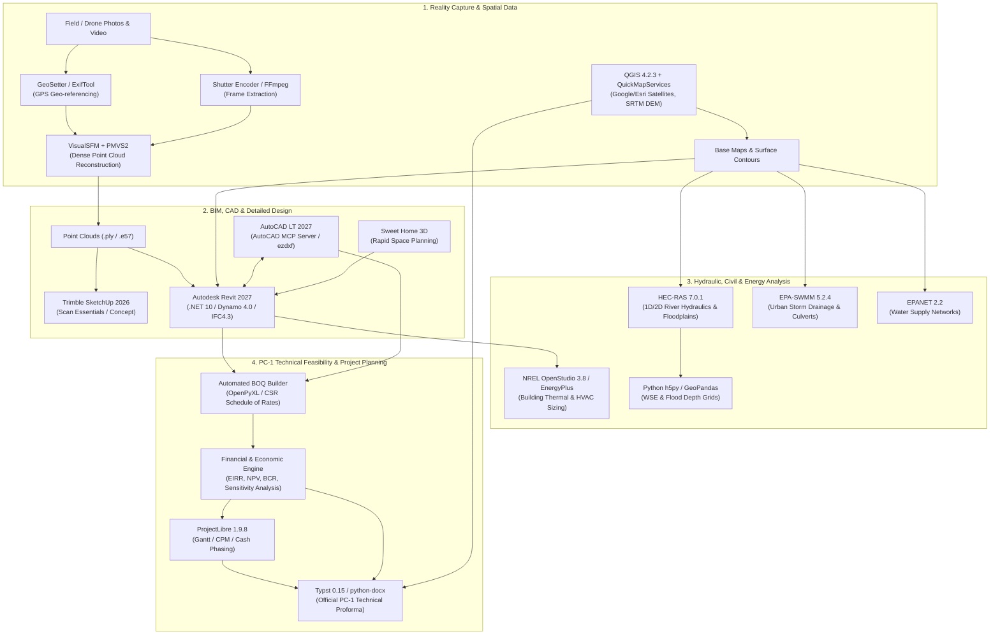

# Comprehensive Engineering Applications Operating Handbook
**System Scan & Operational Mastery Reference for Installed, Portable & Newly Configured Tools**
*Target Machine: Windows x64 | Analysis & Verification Timestamp: 2026-10-21*

---

## 1. Master Architecture & Engineering Workflow



---

## 2. BIM, Architectural & Civil CAD Engineering

### 2.1 Autodesk Revit 2027
* **Installed Path**: `C:\Program Files\Autodesk\Revit 2027\Revit.exe`
* **Version**: `27.0.4.412` (with Add-Ins Manager, Steel Connections Content, and Interoperability Engine)
* **API Framework**: **.NET 10 (`net10.0-windows`)** / Dynamo 4.0 / pyRevit
* **Engineering Capabilities**: Full parametric BIM modeling (Architectural, Structural, MEP), IFC4.3 import/export, analytical model generation for structural solvers, energy analytical model generation.
* **Headless Batch Journal**:
  ```cmd
  "C:\Program Files\Autodesk\Revit 2027\Revit.exe" "C:\Models\Project.rvt" "C:\Scripts\BatchExportIFC.txt"
  ```

### 2.2 Autodesk AutoCAD LT 2027 & AutoCAD MCP Server
* **Installed Path**: `C:\Program Files\Autodesk\AutoCAD LT 2027\acadlt.exe`
* **AutoCAD MCP Server**: `C:\Program Files\Autodesk\ApplicationPlugins\AutoCAD-MCP-Server-2027.bundle\` (`acmcp.dll`, `aeccmcp.dll`)
* **Engineering Capabilities**: Precision 2D drafting, site layouts, civil profile sheets, detail drafting, native DWG format.
* **Automation Workflow**:
  - Direct AI MCP interaction via `acmcp.dll`.
  - Python-driven DXF generation via `ezdxf` with layer control, line weights, and dimension styles.
  - Script automation (`.scr`):
    ```cmd
    "C:\Program Files\Autodesk\AutoCAD LT 2027\acadlt.exe" /b "C:\Scripts\generate_grid.scr" "C:\Drawings\site_plan.dwg"
    ```

### 2.3 Trimble SketchUp Pro 2026
* **Installed Path**: `C:\Program Files\SketchUp\SketchUp 2026\SketchUp.exe`
* **Plugins Installed**: `msi_revit_importer` (2026.1.1), `msi_scan_essentials_su` (2026.1), `msi_scan_essentials_lo`
* **Engineering Capabilities**: Rapid 3D concept modeling, point cloud modeling via Scan Essentials, direct `.rvt` to SketchUp import, LayOut 2026 construction document generation.

### 2.4 Sweet Home 3D (v7.5)
* **Installed Path**: `C:\Program Files\Sweet Home 3D\SweetHome3D.exe`
* **File Format**: `.sh3d` (ZIP archive containing `Home.xml` and textures)
* **Engineering Capabilities**: Rapid architectural floor planning, interior space allocation, clearance and furniture fit checks, 2D floor plans with 3D synchronized views.

---

## 3. Urban Drainage, Water Supply & River Hydraulics

### 3.1 EPA-SWMM 5.2.4 (Storm Water Management Model)
* **Installed Path**: `C:\Program Files\EPA SWMM 5.2.4 (64-bit)\epaswmm5.exe`
* **CLI Engine**: `C:\Program Files\EPA SWMM 5.2.4 (64-bit)\runswmm.exe`
* **PC-1 & Civil Applications**:
  - Roadside drainage design (curb & gutter, longitudinal trapezoidal ditches).
  - Cross-drainage culvert capacity and backwater checks.
  - Detention/retention pond sizing for peak runoff attenuation in urban developments.
* **Headless Simulation**:
  ```cmd
  "C:\Program Files\EPA SWMM 5.2.4 (64-bit)\runswmm.exe" "drainage_network.inp" "report.rpt" "output.out"
  ```

### 3.2 EPANET 2.2 (Water Distribution Systems)
* **Installed Path**: `C:\Program Files (x86)\EPANET 2.2\Epanet2w.exe`
* **CLI Engine**: `C:\Program Files (x86)\EPANET 2.2\runepanet.exe`
* **PC-1 & Civil Applications**:
  - Municipal and rural gravity/pumped drinking water supply networks.
  - Sizing overhead service reservoirs (OHSR), distribution mains, and booster pumps.
  - Pressure head and residual chlorine tracking.
* **Headless Simulation**:
  ```cmd
  "C:\Program Files (x86)\EPANET 2.2\runepanet.exe" "network.inp" "results.rpt" "results.out"
  ```

### 3.3 USACE HEC-RAS 7.0.1 (River Analysis System)
* **Installed Path**: `C:\Program Files (x86)\HEC\HEC-RAS\7.0.1\Ras.exe`
* **Computational Engines**:
  - `x64\RasGeomPreprocess.exe`: Geometric pre-processing.
  - `x64\RasSteady.exe`: 1D steady flow backwater profiles.
  - `x64\RasUnsteady.exe`: 1D/2D unsteady flow simulation.
* **Automation via Python**:
  ```python
  import subprocess
  import h5py

  # 1. Run simulation headlessly
  engine = r"C:\Program Files (x86)\HEC\HEC-RAS\7.0.1\x64\RasUnsteady.exe"
  subprocess.run([engine, r"C:\Hydraulics\Model.prj", "-p", "p01"], check=True)

  # 2. Extract Water Surface Elevation (WSE) directly from HDF5
  with h5py.File(r"C:\Hydraulics\Model.p01.hdf", "r") as hdf:
      wse_max = hdf["Results/Unsteady/Output/Output Blocks/Base Output/Summary Output/2D Flow Areas/Max Water Surface"][:]
      print("Maximum Water Surface Elevations Extracted:", wse_max.shape)
  ```

---

## 4. Building Energy & Environmental Simulation

### 4.1 NREL OpenStudio 3.8.0 & EnergyPlus
* **Installed Path**: `C:\Program Files\NREL\OpenStudio CLI For Revit 2027\bin\openstudio.exe`
* **EnergyPlus Engine**: `C:\Program Files\NREL\OpenStudio CLI For Revit 2027\EnergyPlus\`
* **Engineering Capabilities**: Annual building energy simulation, ASHRAE 90.1 baseline comparison, HVAC equipment sizing, peak heating and cooling loads.
* **CLI Execution**:
  ```cmd
  "C:\Program Files\NREL\OpenStudio CLI For Revit 2027\bin\openstudio.exe" run -w "workflow.osw"
  ```

---

## 5. Geospatial, GIS & Aerial Survey Analysis

### 5.1 QGIS 4.2.3 'Belém do Pará' + Civil Plugins
* **Installed Path**: `C:\Program Files\QGIS 4.2.3\bin\qgis-bin.exe`
* **Configured Plugins**:
  - `quick_map_services` + `quickmapservices_contrib`: One-click access to Google Satellite, Google Hybrid, Esri World Imagery, and Bing Maps.
  - `profiletool`: Instant terrain elevation profiles and cross-sections along road centerlines and rivers.
  - `Qgis2threejs`: Web-based interactive 3D terrain visualization export.
  - `qgis_mcp_plugin`: Direct AI control via QGIS MCP Server.
* **GDAL/OGR Toolset**:
  - Topographic contour generation:
    ```cmd
    gdal_contour -a elev -i 1.0 "site_dem.tif" "contours_1m.shp"
    ```
  - Reprojecting to project UTM zone:
    ```cmd
    gdalwarp -t_srs EPSG:32642 "input.tif" "reprojected_utm.tif"
    ```
  - GIS vector to CAD DXF export:
    ```cmd
    ogr2ogr -f "DXF" "site_boundaries.dxf" "site_parcels.shp"
    ```

### 5.2 Google Earth Pro
* **Installed Path**: `C:\Program Files\Google\Google Earth Pro\client\googleearth.exe`
* **Engineering Capabilities**: Geotechnical desk studies, historical satellite image comparison, interactive 3D site fly-throughs via programmatic KML/KMZ.

### 5.3 GeoSetter & ExifTool (UAV Geotagging)
* **Portable Path**: `D:\Portable Apps\geosetter\tools\exiftool.exe`
* **Automation**: Geotagging UAV inspection photos with GPS flight logs:
  ```cmd
  exiftool.exe -geotag "flight_log.gpx" -geosync=+05:00 "D:\SurveyPhotos\"
  ```

---

## 6. Photogrammetry, 3D Reality Capture & Computer Vision

### 6.1 VisualSFM & CMVS/PMVS2
* **Portable Path**: `D:\Portable Apps\VisualSFM_windows_cuda_64bit\VisualSFM.exe`
* **Engineering Capabilities**: Structure-from-Motion (SfM) dense 3D point cloud generation from drone photos with NVIDIA CUDA acceleration.
* **CLI Automation**:
  ```cmd
  VisualSFM.exe sfm+pmvs "D:\DroneFlightImages" "D:\PointClouds\site_model.nvm"
  ```

### 6.2 Blender 5.2.1 LTS
* **Installed Path**: `C:\Program Files\Blender Foundation\Blender 5.2\blender.exe`
* **Engineering Capabilities**: Procedural geometry generation, point cloud mesh decimation and LOD generation, Cycles photorealistic architectural renderings, structural collapse simulation.
* **Headless Scripting**:
  ```cmd
  blender.exe -b -P "process_site_mesh.py" -- "input_scan.ply" "output_decimated.obj"
  ```

### 6.3 ImageJ / ij150 (Scientific Image Metrology)
* **Portable Path**: `D:\Portable Apps\ij150-win-java8\ImageJ.exe`
* **Engineering Capabilities**: Concrete crack width measurement, metallurgical grain sizing, porosity ratio calculation, aggregate distribution analysis.
* **Headless Batch Macro**:
  ```cmd
  ImageJ.exe -batch "measure_cracks.ijm" "C:\InspectionPhotos\"
  ```

### 6.4 Shutter Encoder & Real-ESRGAN Vulkan
* **Portable Directory**: `D:\Portable Apps\Shutter Encoder 19.2 Windows 64bits\Library\`
* **Frame Extraction for Photogrammetry**:
  ```cmd
  ffmpeg -i "drone_flight.mp4" -vf "fps=1,scale=3840:2160" -qscale:v 2 "frames/frame_%04d.jpg"
  ```
* **AI 4x Super-Resolution Upscaling**:
  ```cmd
  realesrgan-ncnn-vulkan.exe -i "lowres_plan.jpg" -o "upscaled_plan.png" -s 4 -n realesrgan-x4plus
  ```

---

## 7. PC-1 Technical Feasibility, BOQ & Economic Analysis Stack

### 7.1 Python Feasibility Engine (`.venv`)
The dedicated `.venv` in the workspace contains the full computational stack:
* `scipy` & `numpy`: Numerical optimization and root-finding for exact EIRR.
* `pandas` & `openpyxl`: Automated Bill of Quantities (BOQ) with Composite Schedule of Rates (CSR) lookup.
* `python-docx`: Standard Planning Commission Proforma 1 generation in Microsoft Word format.
* `matplotlib`: Cash flow phasing bar charts, S-Curves (physical vs. financial progress).
* `geopandas`, `shapely`, `whitebox`: Site spatial calculations, parcel area takeoffs, catchment geometry.
* `ezdxf`: Programmatic typical cross-sections and detail drawings.

#### Core PC-1 Economic Evaluation Model:
```python
import numpy as np
import scipy.optimize as opt

def evaluate_pc1(costs, benefits, discount_rate=0.12):
    """
    Computes standard Planning Commission financial metrics:
    - Present Value of Costs (PVC)
    - Present Value of Benefits (PVB)
    - Net Present Value (NPV)
    - Benefit-Cost Ratio (BCR)
    - Economic Internal Rate of Return (EIRR)
    """
    years = np.arange(len(costs))
    discount_factors = 1.0 / ((1.0 + discount_rate) ** years)
    
    pvc = np.sum(np.array(costs) * discount_factors)
    pvb = np.sum(np.array(benefits) * discount_factors)
    npv = pvb - pvc
    bcr = pvb / pvc if pvc > 0 else np.nan
    
    net_cf = np.array(benefits) - np.array(costs)
    def npv_curve(r):
        return np.sum(net_cf / ((1.0 + r) ** years))
    
    try:
        eirr = opt.brentq(npv_curve, -0.9, 2.0)
    except Exception:
        eirr = np.nan
        
    return {'PVC': pvc, 'PVB': pvb, 'NPV': npv, 'BCR': bcr, 'EIRR': eirr}
```

### 7.2 ProjectLibre 1.9.8 (Project Implementation Scheduling)
* **Installed Path**: `C:\Program Files\ProjectLibre\ProjectLibre.exe`
* **PC-1 Application**: Item 11 Implementation Schedule. Generation of Work Breakdown Structures (WBS), Gantt charts, Critical Path Method (CPM) networks, and multi-year financial phasing.

### 7.3 Typst 0.15.1 (Publication-Grade Technical Reports)
* **Binary Path**: `typst` (in global PATH)
* **PC-1 Application**: Compiling executive summaries, geotechnical feasibility studies, and multi-page technical reports into clean PDFs with high-resolution vector tables and math formulas.
* **CLI Command**:
  ```cmd
  typst compile "report.typ" "PC1_Technical_Report.pdf"
  ```

---

## 8. Document Assembly, Plan Set & Drawing Management

### 8.1 PDF-XChange PRO 11.1
* **Installed Path**: `C:\Program Files\PDF-XChange\PDF Tools\PXCTools.exe`
* **Capabilities**: Takeoff measurement calibration (area, distance, perimeter), OCR, comment flattening.
* **Batch Command**:
  ```cmd
  PXCTools.exe /RunTool:showui=no;showprog=no;showrep=no pdft.tool.flattenComments "input.pdf" /Output:folder="C:\Issued\";filename="Issued.pdf";overwrite=yes
  ```

### 8.2 PDFtk Builder Portable (`pdftk.exe`)
* **Binary Path**: `D:\Portable Apps\PDFTKBuilderPortable\App\pdftkbuilder\pdftk.exe`
* **Commands**:
  - Merge: `pdftk Arch.pdf Struct.pdf Civil.pdf cat output Complete_PC1_Set.pdf`
  - Rotate Landscape Drawings: `pdftk set.pdf cat 1-endeast output set_rotated.pdf`
  - Apply Confidential / Revision Watermark: `pdftk drawings.pdf stamp Stamp.pdf output tender_set.pdf`

### 8.3 Able2Extract Professional v7.0
* **Portable Path**: `D:\Portable Apps\Able2Extract Professional v7.0 Portable\Able2Extract Professional v7.0.exe`
* **Capabilities**: Direct vector PDF to DWG/DXF extraction; tabular schedule extraction from PDF into Excel.

### 8.4 Advanced Renamer (`arenc.exe`)
* **Binary Path**: `D:\Portable Apps\Advanced renamer portable\arenc.exe`
* **Capabilities**: Automated batch file renaming enforcing ISO 19650 BIM drawing conventions.

### 8.5 Everything (`Everything.exe`)
* **Binary Path**: `D:\Portable Apps\Everything-1.4.1.928.x64\Everything.exe`
* **Capabilities**: Sub-millisecond index search across CAD libraries, drawing sets, and project drives.

---

## Master Engineering Toolchain Reference

| Software | Version | Binary / Invocation Path | Key Capabilities & Roles |
| :--- | :--- | :--- | :--- |
| **Autodesk Revit** | 2027 | `C:\Program Files\Autodesk\Revit 2027\Revit.exe` | BIM Architecture & Structure (.NET 10 API, IFC4.3) |
| **AutoCAD LT** | 2027 | `C:\Program Files\Autodesk\AutoCAD LT 2027\acadlt.exe` | 2D/3D CAD drafting, AutoCAD MCP Server (`acmcp.dll`) |
| **EPA-SWMM** | 5.2.4 | `C:\Program Files\EPA SWMM 5.2.4 (64-bit)\runswmm.exe` | Road stormwater drainage, culvert sizing, detention ponds |
| **EPANET** | 2.2.0 | `C:\Program Files (x86)\EPANET 2.2\runepanet.exe` | Water supply networks, pressure heads, pipe sizing |
| **HEC-RAS** | 7.0.1 | `C:\Program Files (x86)\HEC\HEC-RAS\7.0.1\x64\RasUnsteady.exe` | 1D/2D river hydraulics, backwater, flood inundation |
| **QGIS** | 4.2.3 | `C:\Program Files\QGIS 4.2.3\bin\qgis-bin.exe` | GIS mapping, QuickMapServices, Profile Tool, GDAL CLI |
| **ProjectLibre** | 1.9.8 | `C:\Program Files\ProjectLibre\ProjectLibre.exe` | PC-1 Implementation schedule, Gantt charts, CPM |
| **Typst** | 0.15.1 | `typst` (Global PATH) | High-speed PDF technical report & proforma generation |
| **Git** | 2.55.0 | `C:\Program Files\Git\cmd\git.exe` | Version control & automated repository sync |
| **Python Stack** | 3.12 | `.\.venv\Scripts\python.exe` | PC-1 EIRR/NPV/BCR, BOQ, GeoPandas, WhiteboxTools, ezdxf |
| **OpenStudio** | 3.8.0 | `C:\Program Files\NREL\OpenStudio CLI For Revit 2027\bin\openstudio.exe` | Building energy simulation & HVAC load sizing |
| **Trimble SketchUp**| 2026 | `C:\Program Files\SketchUp\SketchUp 2026\SketchUp.exe` | Scan Essentials point cloud modeling, LayOut 2026 |
| **Sweet Home 3D** | 7.5 | `C:\Program Files\Sweet Home 3D\SweetHome3D.exe` | Rapid space planning, 2D/3D floor layouts |
| **Blender** | 5.2.1 | `C:\Program Files\Blender Foundation\Blender 5.2\blender.exe` | Procedural 3D mesh processing & Cycles raytracing |
| **VisualSFM** | 0.5 | `D:\Portable Apps\VisualSFM_windows_cuda_64bit\VisualSFM.exe` | Photogrammetric 3D reconstruction with CUDA |
| **ImageJ** | 1.50 | `D:\Portable Apps\ij150-win-java8\ImageJ.exe` | Concrete crack & material microstructure metrology |
| **Shutter Encoder**| 19.2 | `D:\Portable Apps\Shutter Encoder 19.2 Windows 64bits\Library\` | FFmpeg frame slicing & Real-ESRGAN AI 4x upscaling |
| **PDF-XChange PRO**| 11.1 | `C:\Program Files\PDF-XChange\PDF Tools\PXCTools.exe` | Plan takeoff measurement calibration, OCR |
| **PDFtk Builder** | 1.41 | `D:\Portable Apps\PDFTKBuilderPortable\App\pdftkbuilder\pdftk.exe` | Automated PDF plan set collation & rotation |
| **Able2Extract Pro**| 7.0 | `D:\Portable Apps\Able2Extract Professional v7.0 Portable\` | Vector PDF to DWG/DXF & Table to Excel |
| **GeoSetter** | 3.5 | `D:\Portable Apps\geosetter\tools\exiftool.exe` | UAV flight log GPS synchronization |
| **Advanced Renamer**| 3.84 | `D:\Portable Apps\Advanced renamer portable\arenc.exe` | ISO 19650 BIM drawing numbering automation |
| **Everything** | 1.4 | `D:\Portable Apps\Everything-1.4.1.928.x64\Everything.exe` | Sub-millisecond multi-drive file search |
